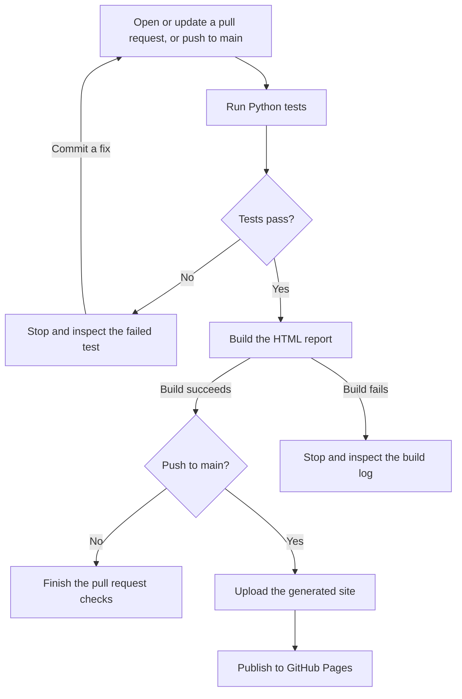

# Simulation Test Report

Build and deploy a small Python project with GitHub Actions. The project reads sample driver-assistance test results from a CSV file, counts the outcomes, and produces a web page. You can complete the GitHub exercise in your browser.

## What the pipeline does

- **Continuous integration (CI)** gives you fast feedback when code changes. Here, GitHub runs four Python tests and builds the HTML on a pull request to `main` and on pushes to `main`.
- **Continuous deployment (CD)** automatically publishes a verified change. Here, a successful run on `main` publishes the new report to GitHub Pages. In continuous delivery, the build is kept ready for release and the production deployment can require a manual decision.



## 1. Run the pipeline on GitHub

1. Extract the ZIP. On Windows, right-click it and choose **Extract All**.
2. Open [GitHub's new repository page](https://github.com/new). Pick **Public**, name it `simulation-test-report`, and enable **Add README** so GitHub creates a starting commit. Create the repository. These steps assume your default branch is `main`. GitHub Pages is available for public repositories on GitHub Free.
3. Under **Code**, choose **Add file → Upload files**. Upload only `report.py`, `test_report.py`, `results.csv`, and `template.html`. Commit them directly to `main`. You can replace the default README later with this guide if you want to include it in the repo.
4. Go to **Settings → Pages**. Under **Build and deployment**, select **GitHub Actions** for **Source**.
5. Return to **Code → Add file → Create new file**. Type `.github/workflows/ci-cd.yml` into the filename field, including the leading dot. Open the file with the same path in the extracted project with a plain text editor such as Notepad, copy its contents into GitHub, and commit directly to `main`. Creating it through GitHub ensures it is in the workflow folder. The commit starts the workflow.
6. Go to **Actions → Simulation Report CI/CD** and open the latest run. In **Test and build**, find the **Run Python tests** step. It should say `Ran 4 tests` and `OK`. Once **Publish report** finishes, open the site from **Settings → Pages**. The sample page shows **4 total, 3 passed, 1 failed**.

See [GitHub's Pages setup guide](https://docs.github.com/en/get-started/start-your-journey/deploying-your-website-automatically) for the same GitHub screens.

## 2. Make CI fail, fix it, and publish a change

A **branch** is a separate line of work. A **commit** saves a change. A **pull request** proposes merging that branch into `main`.

1. Open `report.py` on GitHub and click the pencil icon. Change `passed += 1` to `passed += 2`. When committing, choose to create a new branch, name it `practice-ci`, and open a pull request into `main`.
2. Open the pull request's failed check. Expand **Run Python tests** and find `test_counts_mixed_results`. Its input has two passing results and the buggy code counts four. The build step is skipped. The live site still shows the previous report.
3. While viewing the `practice-ci` branch, edit `report.py` back to `passed += 1` and commit to this same branch. The pull request automatically gets a fresh check. Confirm it turns green.
4. Still on `practice-ci`, append `Blind spot monitor,PASS` to `results.csv` and commit. When the pull request check is green again, choose **Merge pull request**.
5. Open **Actions** and watch the new run on `main`. After **Publish report** succeeds, reload your site. It should now show **5 total, 4 passed, 1 failed**.

The website's sample `FAIL` is a data value. The red GitHub check means the Python program itself behaved differently from what a test expected.

## 3. Read the workflow file

| Term | Where it appears |
| --- | --- |
| **Workflow** | The automation instructions in `.github/workflows/ci-cd.yml`. YAML uses indentation to group instructions. |
| **Trigger** | `on` lists the GitHub events that start a run. |
| **Job** | `test-and-build` and `deploy` group related steps. |
| **Runner** | `runs-on: ubuntu-latest` asks GitHub for a Linux machine to execute the job. |
| **Step** | `run` executes a shell command. `uses` calls a reusable action. |
| **Artifact** | The uploaded `site/` folder contains the generated HTML that the deployment job publishes. |
| **Dependency** | `needs: test-and-build` makes deployment wait for a successful test and build job. |
| **Condition** | `if: github.event_name == 'push'` limits publishing steps to pushes. The trigger already restricts those pushes to `main`. |

## Optional local run

If Python is already installed, open a terminal in the extracted project folder. On Windows, use `py` in place of `python` if needed.

```bash
python -m unittest -v
python report.py
```

Open `site/index.html` in your browser. The workflow runs the same two commands on GitHub.
